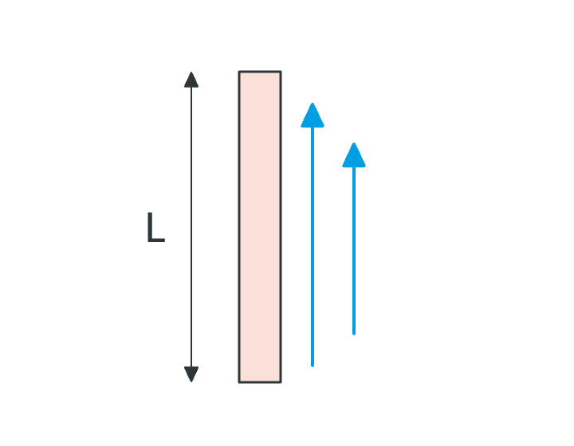
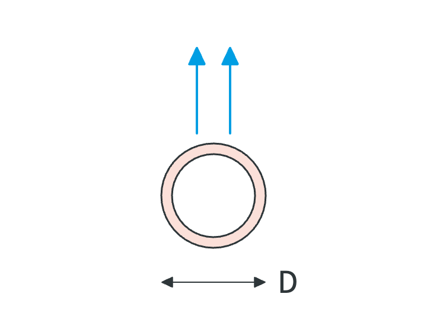
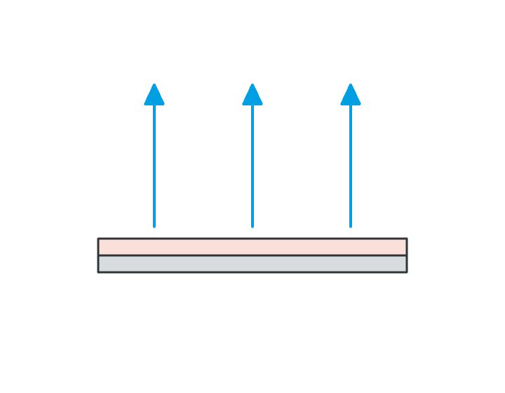
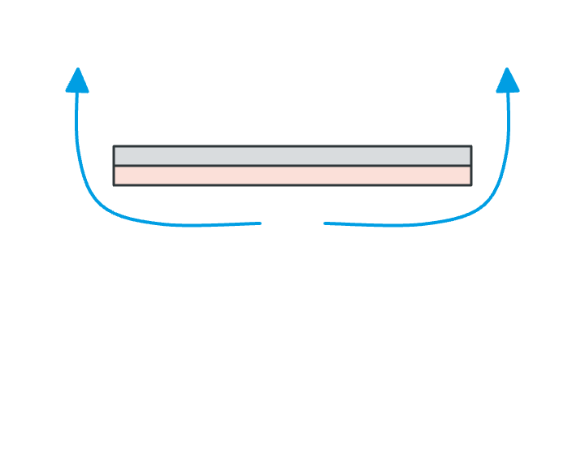
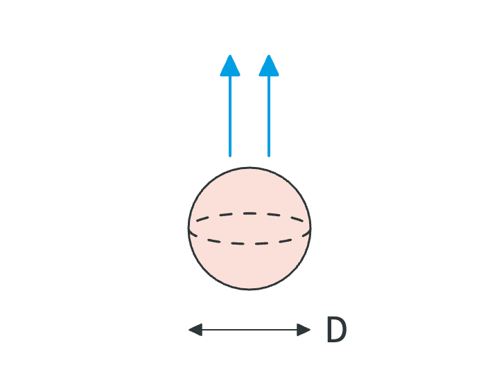
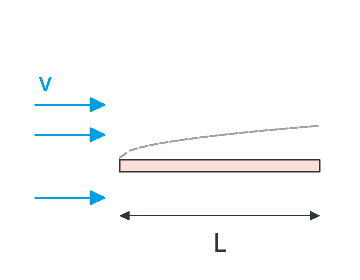
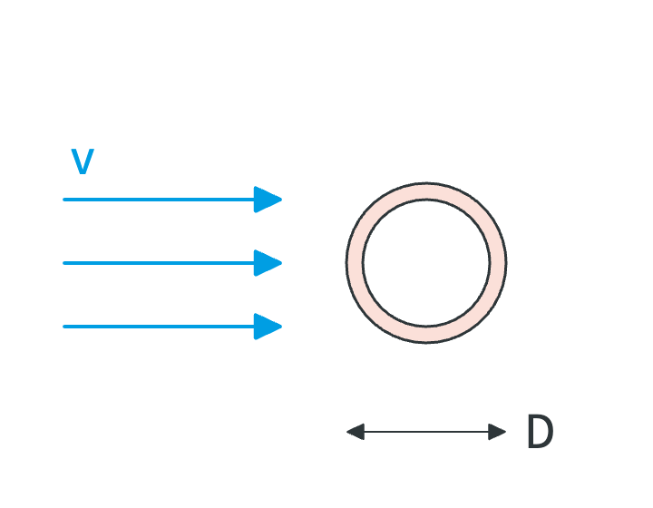
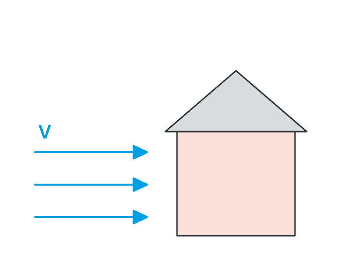
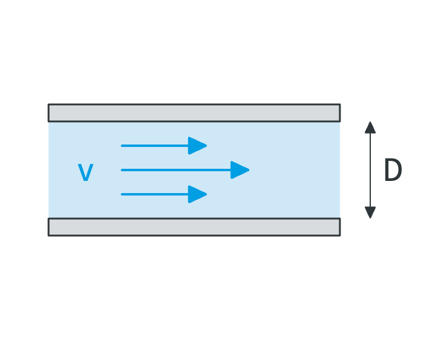

# Konvektion

Konvektion ist der Wärmeübergang zwischen einer Oberfläche und einem
strömenden Fluid, also Luft oder Wasser. In ANSYS ist das die Randbedingung
`Convection`. Sie braucht zwei Zahlen: die Temperatur des Fluids und den
**Wärmeübergangskoeffizienten α**. Die Temperatur ist meist bekannt, α nicht.
Diese Seite erklärt, woher α kommt, und dient als Nachschlagewerk, um α
abzuschätzen. Jede Zahl hat eine Quelle (unten auf der Seite).

## Newtonsches Abkühlungsgesetz

$$
\dot q = \alpha \, (T_O - T_F)
$$

mit

- $\dot q$: Wärmestromdichte von der Oberfläche ins Fluid in W/m²
- $\alpha$: Wärmeübergangskoeffizient in W/(m²·K)
- $T_O$: Temperatur der Oberfläche
- $T_F$: Temperatur des Fluids weit weg von der Oberfläche

Die Formel sieht einfach aus, weil die ganze Physik in α steckt.

## Woher α kommt: die Grenzschicht

- Direkt an der Oberfläche haftet das Fluid, seine Geschwindigkeit ist dort null. Durch diese Schicht kommt die Wärme nur durch Leitung
- Die Temperatur ändert sich nur in einer dünnen Schicht nahe der Oberfläche, der **Grenzschicht**. Sie ist oft nur wenige Millimeter dick
- Die Wärme muss durch diese Schicht geleitet werden: Je dünner sie ist, desto steiler fällt die Temperatur und desto mehr Wärme fließt. Grob gilt deshalb $\alpha \approx \lambda_F / \delta$ mit der Wärmeleitfähigkeit $\lambda_F$ des Fluids in W/(m·K) und der Dicke $\delta$ der Grenzschicht in m
- Schnellere Strömung macht die Grenzschicht dünner, α wird größer
- Wasser leitet Wärme rund 25-mal besser als Luft (0,6 gegen 0,025 W/(m·K)). Bei ähnlicher Strömung ist α für Wasser deshalb viel größer
- α ist **keine Stoffeigenschaft**: Es hängt vom Fluid, von der Geschwindigkeit, von Form und Lage der Oberfläche und bei freier Konvektion auch vom Temperaturunterschied ab

## Freie und erzwungene Konvektion

- **Erzwungen:** Eine Pumpe, ein Lüfter oder der Wind bewegt das Fluid. α hängt vor allem von der Geschwindigkeit ab
- **Frei:** Das Fluid an einer warmen Oberfläche wird leichter und steigt auf, an einer kalten sinkt es ab. Die Strömung entsteht erst durch den Temperaturunterschied. Deshalb wächst α mit dem Temperaturunterschied, in ruhender Luft bei kleinen Bauteilen etwa mit $\Delta T^{1/4}$
- Ist der Temperaturunterschied zu klein, um das Fluid in Bewegung zu bringen, bleibt nur Wärmeleitung im Fluid, zum Beispiel in schmalen Luftspalten

## Typische Werte

<figure style="text-align:center;">
  
  <figcaption>Typische Bereiche nach Çengel 2002, Tab. 1-5</figcaption>
</figure>

| Art der Konvektion | α in W/(m²·K) |
|---|---|
| freie Konvektion, Gase | 2 bis 25 |
| erzwungene Konvektion, Gase | 25 bis 250 |
| freie Konvektion, Flüssigkeiten | 10 bis 1000 |
| erzwungene Konvektion, Flüssigkeiten | 50 bis 20 000 |
| Sieden und Kondensieren | 2500 bis 100 000 |

Die Werte in diesem Kurs ordnen sich so ein:

- Ruhende Luft an Rohren und Bauteilen, freie Konvektion: Heizungsrohr 7, Kühlkörper 6 W/(m²·K)
- Luft außen mit leichtem Wind: Vakuumröhre und Erdoberfläche 10 W/(m²·K)
- Wasser im Rohr, erzwungen: Heizungsrohr und Vakuumröhre 1000 W/(m²·K)

## Normwerte der Bauphysik enthalten Strahlung

In der Bauphysik rechnet man mit festen Wärmeübergangswiderständen nach
DIN EN ISO 6946. Sie enthalten **Konvektion und Strahlung zusammen**:

| Stelle | Wärmeübergangswiderstand | entspricht α (Konvektion und Strahlung) |
|---|---|---|
| innen, Wärmestrom waagerecht (Wand) | $R_{si} = 0{,}13\ \mathrm{m^2\,K/W}$ | 7,7 W/(m²·K) |
| innen, Wärmestrom nach oben (Decke) | $R_{si} = 0{,}10\ \mathrm{m^2\,K/W}$ | 10 W/(m²·K) |
| innen, Wärmestrom nach unten (Fußboden) | $R_{si} = 0{,}17\ \mathrm{m^2\,K/W}$ | 5,9 W/(m²·K) |
| außen | $R_{se} = 0{,}04\ \mathrm{m^2\,K/W}$ | 25 W/(m²·K) |

- $R_{si}$, $R_{se}$: Wärmeübergangswiderstand innen und außen, der Kehrwert des Wärmeübergangskoeffizienten
- Innen an einer Wand stecken in den 7,7 W/(m²·K) nur etwa 2,5 W/(m²·K) Konvektion. Die übrigen gut 5 W/(m²·K) sind Strahlung zu den anderen Wänden (bei ε = 0,9 und 20 °C)
- Außen setzt die Norm für die Konvektion $\alpha_K = 4 + 4\,v$ an, mit dem konvektiven Anteil $\alpha_K$ in W/(m²·K) und der Windgeschwindigkeit $v$ in m/s. Die 25 W/(m²·K) gelten für 4 m/s Wind plus Strahlung
  {: #norm-wind }

!!! warning "Strahlung nicht doppelt zählen"
    - P1 rechnet mit diesen Normwerten als Konvektion, die Strahlung steckt darin
    - Wer die Strahlung wie in P2 als eigene Randbedingung setzt, nimmt für die Konvektion nur den konvektiven Anteil, innen an einer Wand etwa 2,5 statt 7,7 W/(m²·K)
    - Sonst zählt die Strahlung doppelt

## Selbst rechnen

Zum Nachschlagen, für das Praktikum nicht nötig: In den Übungen ist α vorgegeben. Wer α selbst abschätzen will, sucht seinen Fall am Bild:

- **Überschlag:** einfache Formel nur für Luft bei Normaldruck, für eine erste Abschätzung
- **genau:** zum Aufklappen, mit runden Werten für Luft und Wasser; andere Temperaturen und Fluide über [Kennzahlen und Stoffwerte](#kennzahlen)

### Ruhende Luft: freie Konvektion {: #ruhende-luft }

Die warme Oberfläche erwärmt die Luft, die Luft steigt auf. Die Überschlagsformeln gelten nur bei laminarer Strömung, also für eine Rayleigh-Zahl unter $10^9$: Rohre und kleine Bauteile liegen fast immer darin, eine raumhohe Wand meist nicht.

- $\Delta T$: Temperaturunterschied zwischen Oberfläche und Luft in K
- $L$, $D$: Länge bzw. Durchmesser in m, je Fall angegeben
- $A$, $p$: Fläche in m² und Umfang in m der Platte

{ .no-lightbox .off-glb }

Senkrechte Wand

- Länge: $L$ = Höhe, gilt auch für senkrechte Zylinder
- Überschlag für Luft: $\alpha \approx 1{,}42\,(\Delta T / L)^{0{,}25}$

??? note "Genau, mit Kennzahlen"
    Für alle $Ra$:

    $$
    \alpha = \frac{\lambda_F}{L} \left[0{,}825 + \frac{0{,}387\,Ra^{1/6}}{\left[1 + (0{,}492/Pr)^{9/16}\right]^{8/27}}\right]^2
    $$

    Für Luft um 25 °C:

    - $Ra \approx 1 \cdot 10^8 \cdot \Delta T \cdot L^3$: Rayleigh-Zahl, dimensionslos, mit $\Delta T$ in K und $L$ in m
    - $Pr = 0{,}73$: Prandtl-Zahl, dimensionslos
    - $\lambda_F = 0{,}026\ \mathrm{W/(m\,K)}$: Wärmeleitfähigkeit der Luft

    Zwischen 7 und 45 °C Filmtemperatur liegt α damit höchstens 10 % daneben. Genauer: [Stoffwerte](#kennzahlen).

    !!! example "Beispiel: Raumwand"
        - 2,5 m hoch, 3 K kälter als die Raumluft (die Luft sinkt dann ab, die Formel gilt genauso)
        - $Ra \approx 1 \cdot 10^8 \cdot 3 \cdot 2{,}5^3 \approx 4{,}7 \cdot 10^9$
        - $Ra$ liegt über $10^9$, die Strömung ist turbulent: Der Überschlag gilt hier nicht, er gäbe $1{,}5\ \mathrm{W/(m^2\,K)}$
        - damit $\alpha \approx 2{,}1\ \mathrm{W/(m^2\,K)}$

{ .no-lightbox .off-glb }

Waagerechtes Rohr

- Länge: $L = D$, Außendurchmesser
- Überschlag für Luft: $\alpha \approx 1{,}32\,(\Delta T / D)^{0{,}25}$
- im Kurs: Heizungsrohr, $\alpha = 7\ \mathrm{W/(m^2\,K)}$

??? note "Genau, mit Kennzahlen"
    Für $Ra \le 10^{12}$:

    $$
    \alpha = \frac{\lambda_F}{D} \left[0{,}6 + \frac{0{,}387\,Ra^{1/6}}{\left[1 + (0{,}559/Pr)^{9/16}\right]^{8/27}}\right]^2
    $$

    Für Luft um 25 °C:

    - $Ra \approx 1 \cdot 10^8 \cdot \Delta T \cdot D^3$: Rayleigh-Zahl, dimensionslos, mit $\Delta T$ in K und $D$ in m
    - $Pr = 0{,}73$: Prandtl-Zahl, dimensionslos
    - $\lambda_F = 0{,}026\ \mathrm{W/(m\,K)}$: Wärmeleitfähigkeit der Luft

    Zwischen 7 und 45 °C Filmtemperatur liegt α damit höchstens 10 % daneben. Genauer: [Stoffwerte](#kennzahlen).

    !!! example "Beispiel: Heizungsrohr aus Übung 1"
        - Rohr außen Ø 26,9 mm, Oberfläche etwa 59 °C, Kellerluft 15 °C, also $\Delta T \approx 44\ \mathrm{K}$
        - Überschlag: $\alpha \approx 1{,}32 \cdot (44 / 0{,}0269)^{0{,}25} \approx 8{,}4\ \mathrm{W/(m^2\,K)}$
        - Genau mit den runden Werten für Luft: $Ra \approx 1 \cdot 10^8 \cdot 44 \cdot 0{,}0269^3 \approx 8{,}6 \cdot 10^4$, damit $\alpha \approx 7{,}3\ \mathrm{W/(m^2\,K)}$
        - Genau mit den Stoffwerten bei 37 °C Filmtemperatur: $Ra \approx 7 \cdot 10^4$, $\alpha \approx 7{,}0\ \mathrm{W/(m^2\,K)}$, genau der Wert der Übung
        - Der Überschlag liegt hier 20 % daneben. Für eine erste Abschätzung reicht das

{ .no-lightbox .off-glb }

Waagerechte Platte, warme Seite oben

- gilt auch für: kalte Seite unten
- Überschlag für Luft: $\alpha \approx 1{,}32\,(\Delta T / L)^{0{,}25}$ mit $L = 4A/p$

??? note "Genau, mit Kennzahlen"
    Hier mit $L = A/p$, ohne Faktor 4:

    - $\alpha = 0{,}54\,(\lambda_F/L)\,Ra^{1/4}$ für $Ra = 10^4$ bis $10^7$
    - $\alpha = 0{,}15\,(\lambda_F/L)\,Ra^{1/3}$ für $Ra = 10^7$ bis $10^{11}$

    Für Luft um 25 °C:

    - $Ra \approx 1 \cdot 10^8 \cdot \Delta T \cdot L^3$: Rayleigh-Zahl, dimensionslos, mit $\Delta T$ in K und $L$ in m, hier $L = A/p$
    - $Pr = 0{,}73$: Prandtl-Zahl, dimensionslos
    - $\lambda_F = 0{,}026\ \mathrm{W/(m\,K)}$: Wärmeleitfähigkeit der Luft

    Zwischen 7 und 45 °C Filmtemperatur liegt α damit höchstens 10 % daneben. Genauer: [Stoffwerte](#kennzahlen).

{ .no-lightbox .off-glb }

Waagerechte Platte, warme Seite unten

- gilt auch für: kalte Seite oben
- Überschlag für Luft: $\alpha \approx 0{,}59\,(\Delta T / L)^{0{,}25}$ mit $L = 4A/p$

??? note "Genau, mit Kennzahlen"
    Hier mit $L = A/p$, ohne Faktor 4:

    - $\alpha = 0{,}27\,(\lambda_F/L)\,Ra^{1/4}$ für $Ra = 10^5$ bis $10^{11}$

    Für Luft um 25 °C:

    - $Ra \approx 1 \cdot 10^8 \cdot \Delta T \cdot L^3$: Rayleigh-Zahl, dimensionslos, mit $\Delta T$ in K und $L$ in m, hier $L = A/p$
    - $Pr = 0{,}73$: Prandtl-Zahl, dimensionslos
    - $\lambda_F = 0{,}026\ \mathrm{W/(m\,K)}$: Wärmeleitfähigkeit der Luft

    Zwischen 7 und 45 °C Filmtemperatur liegt α damit höchstens 10 % daneben. Genauer: [Stoffwerte](#kennzahlen).

{ .no-lightbox .off-glb }

Kugel

- Länge: $L = D$
- Überschlag für Luft: $\alpha \approx 1{,}92\,(\Delta T / D)^{0{,}25}$

### Wind: erzwungene Konvektion außen {: #wind }

Der Wind bewegt die Luft, α hängt vor allem von der Windgeschwindigkeit ab.

- $v$: Windgeschwindigkeit in m/s
- $L$, $D$: Länge bzw. Durchmesser in m, je Fall angegeben
- $\alpha_K$: Anteil der Konvektion an α in W/(m²·K)

{ .no-lightbox .off-glb }

Platte, längs angeströmt

- Länge: $L$ = Länge in Strömungsrichtung
- Überschlag für Luft: $\alpha \approx 3{,}9\,\sqrt{v/L}$, solange die Strömung laminar bleibt, also $v \cdot L$ unter etwa $7\ \mathrm{m^2/s}$
- im Kurs: Erdoberfläche über dem Erdkabel, $\alpha = 10\ \mathrm{W/(m^2\,K)}$

??? note "Genau, mit Kennzahlen"
    Für $0{,}6 \le Pr \le 60$:

    - laminar, $Re < 5 \cdot 10^5$: $\alpha = 0{,}664\,(\lambda_F/L)\,Re^{0{,}5}\,Pr^{1/3}$
    - turbulent ab der Vorderkante, $5 \cdot 10^5 \le Re \le 10^7$: $\alpha = 0{,}037\,(\lambda_F/L)\,Re^{0{,}8}\,Pr^{1/3}$
    - vorn laminar, hinten turbulent: $\alpha = (\lambda_F/L)\,(0{,}037\,Re^{0{,}8} - 871)\,Pr^{1/3}$

    Für Luft um 25 °C:

    - $Re \approx 6{,}4 \cdot 10^4 \cdot v \cdot L$: Reynolds-Zahl, dimensionslos, mit $v$ in m/s und $L$ in m
    - $Pr = 0{,}73$: Prandtl-Zahl, dimensionslos
    - $\lambda_F = 0{,}026\ \mathrm{W/(m\,K)}$: Wärmeleitfähigkeit der Luft

    Zwischen 7 und 45 °C Filmtemperatur liegt α damit höchstens 10 % daneben. Genauer: [Stoffwerte](#kennzahlen).

    Die Überschlagsformel ist die laminare Formel mit den Stoffwerten der Luft aus der Tabelle: Zwischen 7 und 80 °C liegt der Faktor bei 3,83 bis 3,87.

{ .no-lightbox .off-glb }

Rohr, quer angeströmt

- Länge: $L = D$, Außendurchmesser
- Überschlag: keine einfache Formel, „Genau“ aufklappen
- im Kurs: Vakuumröhre, $\alpha = 10\ \mathrm{W/(m^2\,K)}$

??? note "Genau, mit Kennzahlen"
    Für $Re \cdot Pr > 0{,}2$:

    $$
    \alpha = \frac{\lambda_F}{D} \left[0{,}3 + \frac{0{,}62\,Re^{1/2}\,Pr^{1/3}}{\left[1 + (0{,}4/Pr)^{2/3}\right]^{1/4}} \left[1 + \left(\frac{Re}{282\,000}\right)^{5/8}\right]^{4/5}\right]
    $$

    Für Luft um 25 °C:

    - $Re \approx 6{,}4 \cdot 10^4 \cdot v \cdot D$: Reynolds-Zahl, dimensionslos, mit $v$ in m/s und $D$ in m
    - $Pr = 0{,}73$: Prandtl-Zahl, dimensionslos
    - $\lambda_F = 0{,}026\ \mathrm{W/(m\,K)}$: Wärmeleitfähigkeit der Luft

    Zwischen 7 und 45 °C Filmtemperatur liegt α damit höchstens 10 % daneben. Genauer: [Stoffwerte](#kennzahlen).

    !!! example "Beispiel: Vakuumröhre im Wind"
        - Glasrohr Ø 70 mm, Wind 1 m/s
        - $Re \approx 6{,}4 \cdot 10^4 \cdot 1 \cdot 0{,}07 \approx 4500$
        - damit $\alpha \approx 13\ \mathrm{W/(m^2\,K)}$; die Übung nimmt für leichten Wind 10 W/(m²·K) an

{ .no-lightbox .off-glb }

Außenwand eines Gebäudes

- Norm: $\alpha_K = 4 + 4\,v$, nur Konvektion, ohne Strahlung ([Normwerte](#normwerte-der-bauphysik-enthalten-strahlung))
- im Kurs: P1 Außenwand mit dem Normwert 25 W/(m²·K), Strahlung inbegriffen

### Strömung im Rohr {: #stroemung-im-rohr }

Ein Fluid, meist Wasser, strömt durch das Rohr. Die Stoffwerte nimmt man bei der mittleren Temperatur des Fluids.

- $D$: Innendurchmesser in m
- $v$: mittlere Strömungsgeschwindigkeit in m/s

Für Wasser bei 60 °C:

- $Re \approx 2{,}1 \cdot 10^6 \cdot v \cdot D$: Reynolds-Zahl, dimensionslos, mit $v$ in m/s und $D$ in m
- $Pr = 3{,}0$: Prandtl-Zahl, dimensionslos
- $\lambda_F = 0{,}65\ \mathrm{W/(m\,K)}$: Wärmeleitfähigkeit des Wassers
- Wasser ändert sich stark mit der Temperatur, $Pr$ fällt von 9,5 bei 10 °C auf 2,2 bei 80 °C: dann die [Stoffwerte](#kennzahlen) nehmen

{ .no-lightbox .off-glb }

Rohr, innen durchströmt

- Länge: $L = D$, Innendurchmesser
- laminar, $Re < 2300$, voll ausgebildet: $\alpha = 3{,}66\,\lambda_F/D$ bei fester Wandtemperatur, $\alpha = 4{,}36\,\lambda_F/D$ bei festem Wärmestrom
- im Kurs: Wasser im Heizungsrohr und in der Vakuumröhre, $\alpha = 1000\ \mathrm{W/(m^2\,K)}$

??? note "Genau, turbulent"
    - Nach Gnielinski, $3000 < Re < 5 \cdot 10^6$ und $0{,}5 \le Pr \le 2000$:

        $$
        \alpha = \frac{\lambda_F}{D} \cdot \frac{(f/8)\,(Re - 1000)\,Pr}{1 + 12{,}7\,(f/8)^{0{,}5}\,(Pr^{2/3} - 1)} \qquad f = (0{,}790 \ln Re - 1{,}64)^{-2}
        $$

        mit der Reibungszahl $f$ des glatten Rohrs

    - Einfacher, aber ungenauer, nach Dittus und Boelter, $Re > 10\,000$, $0{,}7 \le Pr \le 160$: $\alpha = 0{,}023\,(\lambda_F/D)\,Re^{0{,}8}\,Pr^n$ mit $n = 0{,}4$, wenn das Fluid erwärmt wird, und $n = 0{,}3$, wenn es abkühlt

    !!! example "Beispiel: Wasser im Heizungsrohr"
        - Innen Ø 21,7 mm, Wasser 60 °C, angenommen 0,5 m/s: $Re \approx 22\,900$, also turbulent
        - Gnielinski: $\alpha \approx 3500\ \mathrm{W/(m^2\,K)}$, Dittus und Boelter: $\alpha \approx 2900\ \mathrm{W/(m^2\,K)}$
        - Die Übung rechnet vorsichtig mit 1000 W/(m²·K). Am Ergebnis ändert das kaum etwas: Den Wärmestrom begrenzt die Luft außen, nicht das Wasser innen

### Kennzahlen und Stoffwerte {: #kennzahlen }

??? info "Kennzahlen und Formelzeichen"
    Die genauen Formeln stammen aus den Lehrbüchern. Dort stehen sie in dimensionslosen Kennzahlen,
    damit gelten sie für jedes Fluid und jede Größe:

    - **Nusselt-Zahl** $Nu = \alpha \, L / \lambda_F$: Sie sagt, wie viel besser die Konvektion Wärme überträgt als reine Leitung durch eine ruhende Fluidschicht der Dicke $L$
    - **Reynolds-Zahl** $Re = v\,L / \nu$ für erzwungene Konvektion: klein heißt laminar, groß heißt turbulent
    - **Rayleigh-Zahl** $Ra = g\,\beta\,\Delta T\,L^3 / \nu^2 \cdot Pr$ für freie Konvektion: Sie sagt, wie stark der Auftrieb treibt
    - **Prandtl-Zahl** $Pr$: ein Stoffwert, Luft etwa 0,7, Wasser 2 bis 7

    mit

    - $\alpha$: Wärmeübergangskoeffizient in W/(m²·K)
    - $L$: charakteristische Länge in m, je nach Fall (oben angegeben)
    - $D$: Durchmesser in m, bei Rohren ist $L = D$
    - $\lambda_F$: Wärmeleitfähigkeit des Fluids in W/(m·K)
    - $v$: Strömungsgeschwindigkeit in m/s
    - $\nu$: kinematische Viskosität des Fluids in m²/s
    - $g = 9{,}81\ \mathrm{m/s^2}$: Erdbeschleunigung
    - $\beta$: Wärmeausdehnungskoeffizient in 1/K, für Gase $\beta = 1/T_f$ mit $T_f$ in Kelvin
    - $\Delta T$: Temperaturunterschied zwischen Oberfläche und Fluid in K

    Die Stoffwerte nimmt man bei der **Filmtemperatur** $T_f = (T_O + T_F)/2$,
    bei der Strömung im Rohr bei der mittleren Temperatur des Fluids.

    Die Lehrbücher geben die Formeln für $Nu$ an. Oben sind sie gleich nach
    $\alpha = Nu \cdot \lambda_F / L$ aufgelöst: $Re$ oder $Ra$ ausrechnen, damit
    die passende Formel wählen, $\alpha$ ausrechnen.

    !!! info "Wie genau sind solche Formeln?"
        - Die einfachen Formeln wie Dittus und Boelter können bis zu 25 % danebenliegen, genauere wie Gnielinski unter 10 %
        - Ein so bestimmtes α ist also eine gute Abschätzung, kein exakter Wert
        - Hängt viel an α, lohnt eine Rechnung mit kleinerem und größerem α: Ändert sich das Ergebnis kaum, reicht die Abschätzung

??? info "Stoffwerte von Luft und Wasser"
    Zwischenwerte linear interpolieren. Für Luft gibt die letzte Zeile den Faktor der Rayleigh-Zahl:
    $Ra = (g\,\beta\,Pr/\nu^2) \cdot \Delta T \cdot L^3$.

    | Luft (1 bar), T in °C | 7 | 25 | 45 | 60 | 80 |
    |---|---|---|---|---|---|
    | $\lambda_F$ in W/(m·K) | 0,0242 | 0,0255 | 0,0270 | 0,0281 | 0,0295 |
    | $\nu$ in $10^{-5}$ m²/s | 1,399 | 1,562 | 1,749 | 1,896 | 2,097 |
    | $Pr$ | 0,734 | 0,730 | 0,724 | 0,720 | 0,715 |
    | $g\,\beta\,Pr/\nu^2$ in $10^8$ 1/(K·m³) | 1,31 | 0,98 | 0,73 | 0,59 | 0,45 |

    | Wasser, T in °C | 10 | 20 | 30 | 40 | 50 | 60 | 70 | 80 |
    |---|---|---|---|---|---|---|---|---|
    | $\lambda_F$ in W/(m·K) | 0,579 | 0,598 | 0,614 | 0,628 | 0,641 | 0,651 | 0,660 | 0,667 |
    | $\nu$ in $10^{-6}$ m²/s | 1,306 | 1,003 | 0,801 | 0,658 | 0,553 | 0,474 | 0,413 | 0,364 |
    | $Pr$ | 9,47 | 7,01 | 5,42 | 4,34 | 3,57 | 3,00 | 2,56 | 2,23 |

## Wie man es in der Praxis macht

| Fall | So kommt man an α | Im Kurs |
|---|---|---|
| Wände, Fenster, Decken im Gebäude | [Normwerte nach DIN EN ISO 6946](#normwerte-der-bauphysik-enthalten-strahlung), sie enthalten die Strahlung | P1 Außenwand |
| Rohre und Bauteile in ruhender Luft | freie Konvektion: [Fälle in ruhender Luft](#ruhende-luft) | Heizungsrohr, Kühlkörper |
| Außenflächen im Wind | erzwungene Konvektion: [Fälle im Wind](#wind), an Gebäuden die [Formel der Norm](#norm-wind) | Vakuumröhre, Erdkabel |
| Wasser in Rohren | [Strömung im Rohr](#stroemung-im-rohr), laminar und turbulent | Heizungsrohr, Vakuumröhre |
| Elektronik mit Lüfter | erzwungene Konvektion, oft Angaben des Herstellers | |
| Sieden und Kondensieren | eigene Formeln, hier nicht behandelt, α sehr groß | |
| Wenn es genau sein muss | Strömungssimulation (CFD) oder Messung | |

## In ANSYS

- `Convection`: **Film Coefficient** in W/(m²·°C), das ist dasselbe wie W/(m²·K), und **Ambient Temperature** in °C
- **In diesem Praktikum ist α ein fester Wert.** Das reicht meist aus, die beiden folgenden Möglichkeiten sind nur zum Nachschlagen
- Hängt α stark von der Temperatur ab (freie Konvektion), lässt sich der **Film Coefficient** auch als Tabelle über der Temperatur eingeben
- Unter **Film Coefficient** bietet ANSYS mit `Import Temperature Dependent` fertige Ansätze an. Vorher prüfen, ob der Ansatz passt:
    - „Horizontal Cyl“ ist die Formel für turbulente Strömung und gilt erst für große Rohre. Kleine Rohre sind meist laminar, dort liegt sie um ein Drittel zu niedrig
    - „Vertical Planes1“ und „Vertical Planes2“ gelten für senkrechte Wände mit 1 m und 10 cm Höhe
    - „Simplified Case“ ist ein fester Wert: Luft 5, Wasser 1200 W/(m²·K)

## Quellen

- Y. A. Çengel: *Heat Transfer. A Practical Approach.* 2. Auflage, McGraw-Hill 2002: Abb. 1-32 und Tab. 1-5 (S. 26), Gl. 7-21 bis 7-24 (S. 374), Gl. 7-35 (S. 385), Gl. 8-59 und 8-61 (S. 436), Gl. 8-65, 8-68 und 8-70 (S. 441), Tab. 9-1 (S. 468), Tab. 15-1 (S. 815). Stoffwerte von Luft aus Tab. A-15, wie in den Rechenbeispielen zitiert (S. 377, 387, 388, 470, 482)
- Stoffwerte von Wasser: NIST Chemistry WebBook, Thermophysical Properties of Fluid Systems, Wasser im Sättigungszustand
- DIN EN ISO 6946: Bauteile, Wärmedurchlasswiderstand und Wärmedurchgangskoeffizient (Wärmeübergangswiderstände)
- Ansätze in ANSYS: Bibliothek `Convection_Samples` von ANSYS 2025 R2 (Dialog „Import Convection Data“), ausgewertet mit den Formeln aus J. P. Holman: *Heat Transfer*, 5. Auflage, S. 285; ANSYS Learning Forum, Antwort eines ANSYS-Mitarbeiters zu `Import Temperature Dependent`
