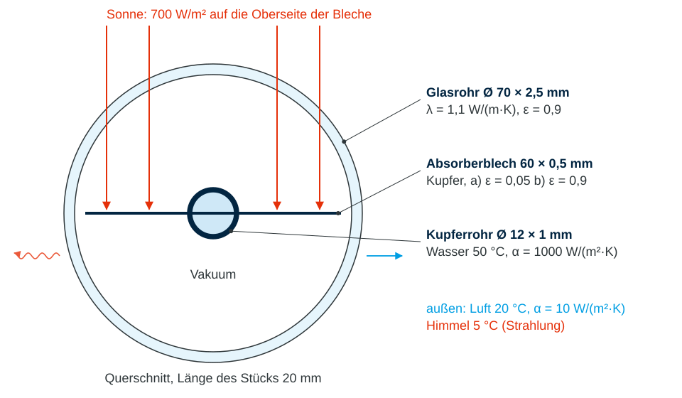

# Vorzeigebeispiel: Vakuumröhre eines Solarkollektors

In einer Vakuumröhre liegt ein Absorberblech mit einem Wasserrohr in einem
Glasrohr. Dazwischen ist **Vakuum**: Es gibt keine Luft, also auch keine
Konvektion. Der Absorber kann Wärme nur noch über **Strahlung** verlieren.
Darum ist er mit einer selektiven Schicht beschichtet, die Sonnenlicht gut
aufnimmt, aber kaum Wärme abstrahlt.

In diesem Beispiel kommen fast alle Randbedingungen vor:

- **Wärmestromdichte:** Sonne auf dem Absorber
- **Konvektion:** Wasser im Rohr, Luft außen am Glas
- **Strahlung To Ambient:** Glas zum Himmel
- **Strahlung Surface to Surface:** Absorber und Glas strahlen sich gegenseitig an

!!! question "Die Aufgabe"
    Für ein 20 mm langes Stück der Röhre die **Temperaturen** von Absorber und
    Glas und die **Nutzwärme** an das Wasser bestimmen, für drei Fälle:

    - **a)** Absorber **selektiv** beschichtet, ε = 0,05
    - **b)** Absorber **schwarz** lackiert, ε = 0,9
    - **c)** **Stillstand**: Das Wasser steht, die Pumpe ist aus (optional)

<figure style="text-align:center;">
  
</figure>

!!! info "Wozu das Absorberblech?"
    Das Rohr allein fängt nur einen 12 mm breiten Streifen Sonne ein, mit dem
    Blech sind es 60 mm: fünfmal so viel Leistung für dieselbe Menge Wasser.
    Ein dünnes Blech ist dafür viel billiger und leichter als ein breites Rohr.

    Das Blech arbeitet wie eine **Rippe**, nur umgekehrt: Die Sonne erwärmt
    jede Stelle des Blechs, die Wärme fließt seitlich zum Rohr. Dafür braucht
    es ein Temperaturgefälle, die Blechkante ist am wärmsten. Bei gleichmäßiger
    Einstrahlung $\dot q$ auf einen Flügel der Länge $L$ und Dicke $t$ ist die
    Kante um

    $$
    \Delta T = \frac{\dot q\,L^2}{2\,\lambda\,t}
    = \frac{700 \cdot 0{,}024^2}{2 \cdot 400 \cdot 0{,}0005}\ \mathrm{K}
    \approx 1\ \mathrm{K}
    $$

    wärmer als der Blechfuß am Rohr. Kupfer leitet so gut, dass das Blech fast
    überall so kalt ist wie das Rohr (hoher **Rippenwirkungsgrad**). Ein
    Stahlblech ($\lambda \approx 50\ \mathrm{W/(m\,K)}$) wäre an der Kante
    schon 8 K wärmer. Ein wärmeres Blech strahlt mehr ab, und diese Wärme
    fehlt im Wasser.

## Gegeben

### Material

<!-- --8<-- [start:Material] -->
| Körper | Wärmeleitfähigkeit |
|---|---|
| Glas (Borosilikatglas) | $\lambda = 1{,}1\ \mathrm{W/(m\,K)}$ |
| Kupfer (Absorberblech und Rohr) | $\lambda = 400\ \mathrm{W/(m\,K)}$ |
<!-- --8<-- [end:Material] -->

### Geometrie

<!-- --8<-- [start:Geometrie] -->
Querschnitt, 20 mm lang ausgezogen:

- Glasrohr Ø 70 mm, Wanddicke 2,5 mm (innen Ø 65 mm)
- Kupferrohr Ø 12 mm, Wanddicke 1 mm (innen Ø 10 mm), in der Mitte
- Absorberblech 60 mm × 0,5 mm, mittig durch das Rohr

Absorberblech und Rohr sind **ein** Körper. Glas und Absorber berühren sich nicht.
<!-- --8<-- [end:Geometrie] -->

### Vernetzung

<!-- --8<-- [start:Vernetzung] -->
- Netzgröße global: 2 mm
<!-- --8<-- [end:Vernetzung] -->

### Randbedingungen

<!-- --8<-- [start:Randbedingungen] -->
| Wo | Randbedingung | Werte |
|---|---|---|
| Oberseite der beiden Blechflügel | Wärmestromdichte (Sonne) | $\dot q = 800 \cdot 0{,}92 \cdot 0{,}95 \approx 700\ \mathrm{W/m^2}$ |
| Innenseite Kupferrohr | Konvektion (Wasser) | $\alpha = 1000\ \mathrm{W/(m^2\,K)}$, $T = 50\ \mathrm{°C}$ |
| Außenseite Glas | Konvektion (Luft) | $\alpha = 10\ \mathrm{W/(m^2\,K)}$, $T = 20\ \mathrm{°C}$ |
| Außenseite Glas | Strahlung To Ambient (Himmel) | $\varepsilon = 0{,}9$, $T = 5\ \mathrm{°C}$ |
| Absorber außen und Glas innen | Strahlung Surface to Surface | Absorber $\varepsilon = 0{,}05$, Glas $\varepsilon = 0{,}9$ |

Die beiden Stirnflächen (Schnitt durch die lange Röhre) bleiben frei, also isoliert.
<!-- --8<-- [end:Randbedingungen] -->

Die Sonne trifft in diesem Modell nur die Blechflügel. Das Rohr selbst und die
kleine Aufnahme im Glas vernachlässigen wir.

!!! info "Selektive Schicht: viel aufnehmen, wenig abstrahlen"
    Sonne und Absorber strahlen in ganz verschiedenen Wellenlängen. Die
    Wellenlänge mit der stärksten Strahlung folgt aus dem Wienschen
    Verschiebungsgesetz $\lambda_{max} = 2898\ \mathrm{µm\,K} / T$:

    | Strahler | Temperatur | $\lambda_{max}$ | Bereich |
    |---|---|---|---|
    | Sonne | 5800 K | 0,5 µm | sichtbares Licht (kurzwellig) |
    | Absorber | 50 °C = 323 K | 9 µm | Infrarot (langwellig) |

    Nach dem **Kirchhoffschen Gesetz** nimmt eine Fläche bei jeder Wellenlänge
    genau so viel auf, wie sie abstrahlt: $\alpha(\lambda) = \varepsilon(\lambda)$.
    Die selektive Schicht nutzt aus, dass das je Wellenlänge verschieden sein
    darf:

    - bei 0,5 µm (Sonnenlicht) **schwarz**: $\alpha_S \approx 0{,}95$
    - bei 9 µm (Wärmestrahlung) **wie blankes Metall**: $\varepsilon \approx 0{,}05$

    Schwarzer Lack ist dagegen bei allen Wellenlängen schwarz: Er nimmt die
    Sonne genauso gut auf, strahlt aber auch mit $\varepsilon \approx 0{,}9$ ab
    (Fall b).

!!! info "Warum ist die Sonne keine Radiation-Randbedingung?"
    Die Radiation-Randbedingung kennt nur **einen** Emissionsgrad für alle
    Wellenlängen (grauer Strahler). Damit gilt dort immer $\alpha = \varepsilon$.
    Mit $\varepsilon = 0{,}05$ würde der Absorber auch nur 5 % der Sonne
    aufnehmen. Dazu kommt das Glas: Sonnenlicht lässt es zu 92 % durch, für
    Wärmestrahlung ist es undurchlässig. In der Randbedingung ist jede Fläche
    undurchlässig.

    Darum rechnet man den kurzwelligen Weg der Sonne von Hand und gibt das
    Ergebnis als Wärmestromdichte vor:

    $$
    \dot q_{Sonne} = G \cdot \tau \cdot \alpha_S
    = 800\ \mathrm{\tfrac{W}{m^2}} \cdot 0{,}92 \cdot 0{,}95
    \approx 700\ \mathrm{\tfrac{W}{m^2}}
    $$

    mit Einstrahlung $G$, Durchlässigkeit des Glases $\tau$ und
    Absorptionsgrad der Schicht für Sonnenlicht $\alpha_S$. Den langwelligen
    Austausch zwischen Absorber, Glas und Himmel rechnet ANSYS mit `Radiation`.
    Dort passt $\alpha = \varepsilon$, weil alle Flächen im Infrarot strahlen.
    Mehr dazu unter [Wärmestrahlung](../../01_Grundlagen/Strahlung.md).

!!! info "Warum ist die Wassertemperatur vorgegeben?"
    Die 50 °C sind der **Betriebspunkt**: An einer bestimmten Stelle im
    Kollektor fließt Wasser mit 50 °C, wie viel Wärme nimmt es dort auf?
    Wie stark sich das Wasser entlang der Röhre erwärmt, ist eine eigene
    Energiebilanz:

    $$
    \Delta T = \frac{\dot Q'\,\ell}{\dot m\,c_p}
    $$

    mit der Nutzwärme je Meter $\dot Q'$, der Länge $\ell$ und dem Massenstrom
    $\dot m$. Selbst bei $\dot Q' = 50\ \mathrm{W/m}$ und
    $\dot m = 0{,}005\ \mathrm{kg/s}$ sind das 2,4 K je Meter, auf unseren
    20 mm nur 0,05 K. In der Scheibe ist die Wassertemperatur also konstant.

    So werden Kollektoren auch geprüft (EN ISO 9806): Man gibt die mittlere
    Fluidtemperatur vor, misst die Leistung und trägt den Wirkungsgrad über
    $(T_m - T_a)/G$ auf. Mit dem Modell geht das genauso: Wassertemperatur
    variieren, jedes Mal Nutzwärme durch Sonnenleistung teilen. Bei Fall c)
    ist es umgekehrt: Ohne Wasserstrom ist die Absorbertemperatur das Ergebnis.

## Gesucht

<!-- --8<-- [start:Gesucht] -->
1. Temperatur von Absorber und Glas
2. Nutzwärme an das Wasser je 20 mm Röhre und je Meter Röhre
3. Anteil der aufgenommenen Sonne, der im Wasser ankommt
<!-- --8<-- [end:Gesucht] -->

??? info "Zum Nachrechnen: Fall a) von Hand abschätzen"
    Für 20 mm Röhre:

    | Fläche | Rechnung | Wert |
    |---|---|---|
    | Sonne (Oberseite der Flügel) | $2 \cdot 24 \cdot 20\ \mathrm{mm^2}$ | $9{,}6 \cdot 10^{-4}\ \mathrm{m^2}$ |
    | Rohr innen | $\pi \cdot 10 \cdot 20\ \mathrm{mm^2}$ | $6{,}3 \cdot 10^{-4}\ \mathrm{m^2}$ |
    | Absorber außen (Flügel beidseitig und Rohr) | $1920 + \pi \cdot 12 \cdot 20\ \mathrm{mm^2}$ | $2{,}67 \cdot 10^{-3}\ \mathrm{m^2}$ |
    | Glas innen | $\pi \cdot 65 \cdot 20\ \mathrm{mm^2}$ | $4{,}08 \cdot 10^{-3}\ \mathrm{m^2}$ |
    | Glas außen | $\pi \cdot 70 \cdot 20\ \mathrm{mm^2}$ | $4{,}40 \cdot 10^{-3}\ \mathrm{m^2}$ |

    **1. Sonne:** $\dot Q_{Sonne} = 700 \cdot 9{,}6 \cdot 10^{-4} = 0{,}672\ \mathrm{W}$

    **2. Absorbertemperatur:** Fast die ganze Sonne geht ins Wasser. Der
    Wärmeübergang ans Wasser braucht

    $$
    \Delta T = \frac{\dot Q}{\alpha\,A} = \frac{0{,}64}{1000 \cdot 6{,}3 \cdot 10^{-4}}\ \mathrm{K} \approx 1\ \mathrm{K},
    $$

    dazu kommt rund 1 K im Blech (siehe „Wozu das Absorberblech?“). Der
    Absorber liegt also bei 51 bis 52 °C.

    **3. Strahlung Absorber zum Glas:** Für einen Körper (1), den ein Rohr (2)
    ganz umschließt, gilt

    $$
    \dot Q_{12} = \frac{\sigma\,A_1\,\left(T_1^4 - T_2^4\right)}
    {\dfrac{1}{\varepsilon_1} + \dfrac{A_1}{A_2}\left(\dfrac{1}{\varepsilon_2} - 1\right)}
    $$

    Mit $T_1 = 324{,}7\ \mathrm{K}$ (51,5 °C) und geschätzt
    $T_2 = 289\ \mathrm{K}$ (16 °C) ergibt das
    $\dot Q_{12} \approx 0{,}031\ \mathrm{W}$. Der Nenner liegt bei 20, fast nur
    wegen $1/\varepsilon_1 = 1/0{,}05$. Die Beschichtung allein bestimmt den Verlust.

    **4. Glastemperatur:** Das Glas bekommt $\dot Q_{12}$ vom Absorber und Wärme
    von der Luft und gibt alles an den Himmel ab:

    $$
    \dot Q_{12} + \alpha_L\,A_a\,(T_L - T_G) = \varepsilon_G\,\sigma\,A_a\,\left(T_G^4 - T_H^4\right)
    $$

    Durch Probieren folgt $T_G \approx 15{,}7\ \mathrm{°C}$. Die Glaswand selbst
    braucht kaum Temperaturunterschied
    ($\dot q\,t/\lambda \approx 7 \cdot 0{,}0025/1{,}1 \approx 0{,}02\ \mathrm{K}$).

    **5. Nutzwärme:** $\dot Q_{Wasser} = \dot Q_{Sonne} - \dot Q_{12} = 0{,}672 - 0{,}031 = 0{,}641\ \mathrm{W}$

    Die Handrechnung gilt für die unendlich lange Röhre. ANSYS liegt mit dem
    20 mm langen Stück knapp daneben: Glas 15,8 bis 15,9 °C, Nutzwärme
    0,639 W. Warum, steht in der Auswertung. Bei Fall b) mit
    $\varepsilon_1 = 0{,}9$ schrumpft der Nenner von 20 auf 1,2. Der Verlust
    wird so groß, dass sich alle Temperaturen deutlich verschieben. Dann
    müssen die Schritte 2 bis 4 mehrfach durchlaufen werden, genau das macht
    ANSYS mit seinen Iterationen.

## Lösungswege

-   <a class="card-link" href="01-modell/">
    __a) Selektiv__: Modell aufbauen, alle Randbedingungen, auswerten
    </a>

-   <a class="card-link" href="b-schwarz/">
    __b) Schwarz__: nur den Emissionsgrad ändern
    </a>

-   <a class="card-link" href="c-stillstand/">
    __c) Stillstand__: Was passiert ohne Wasserstrom? (optional)
    </a>

