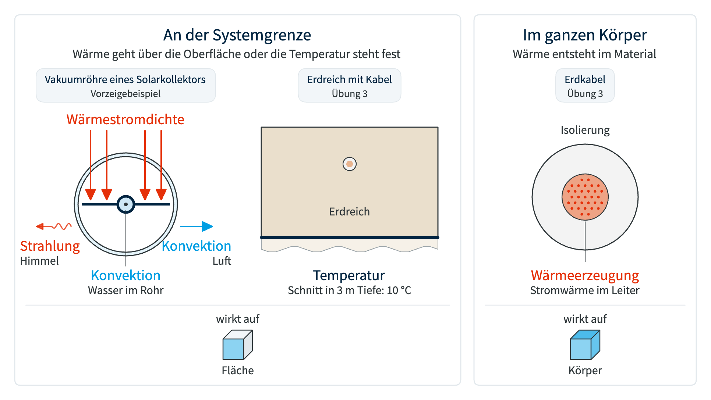
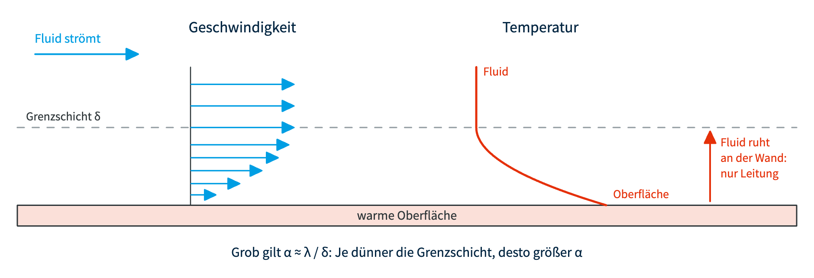
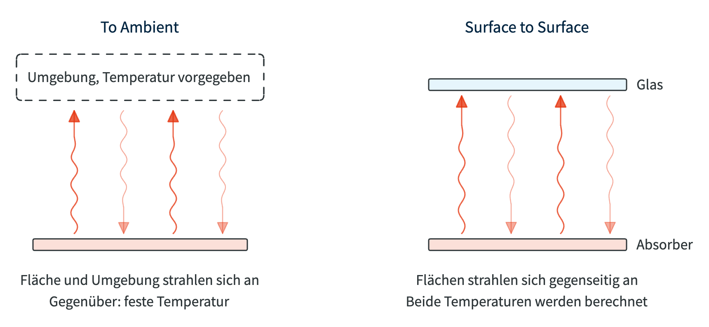
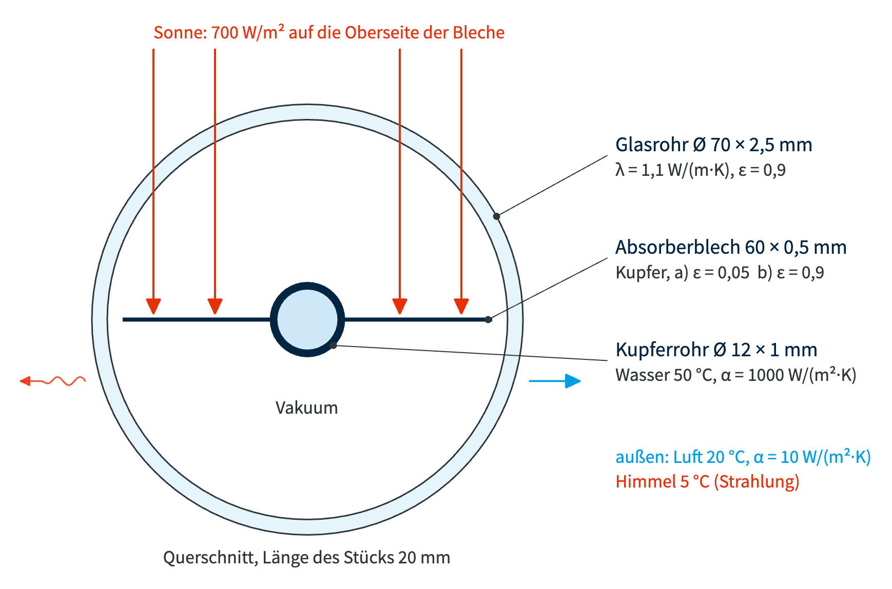
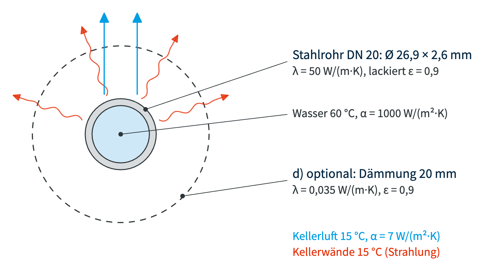
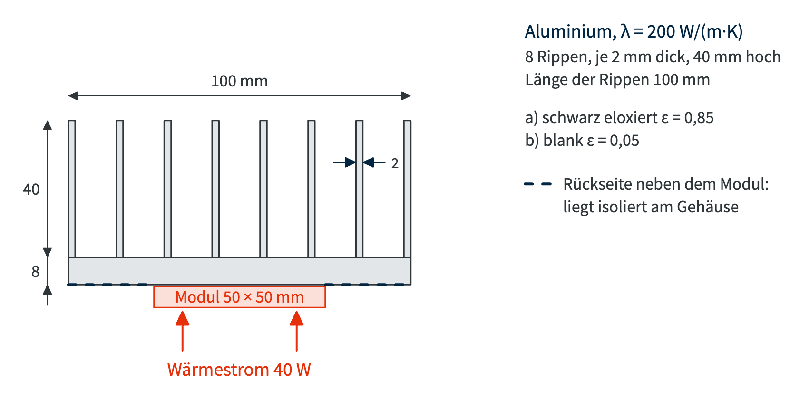
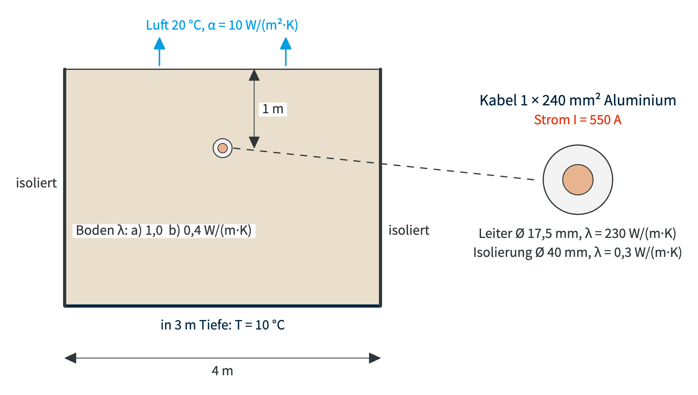

# Randbedingungen

!!! abstract "Lernziele"

    - [ ] Alle thermischen **Randbedingungen** in ANSYS kennen und wissen, wann welche passt (`Grundlagen`)
    - [ ] **Wärmestrahlung** verstehen: Emissionsgrad, Strahlung zur Umgebung und zwischen Flächen (`Grundlagen`)
    - [ ] Mehrere Randbedingungen in einem Modell kombinieren und ihre Wärmeströme auswerten (`Vorzeigebeispiel`)
    - [ ] Die Randbedingungen **selbstständig** auf neue Fälle anwenden, vom Heizungsrohr bis zum Erdkabel (`Übung 1 bis 3`)

Termin: **Mi 04.11.2026**

## Inhalte

  <a class="prakt-card" href="01_Grundlagen/Randbedingungen/">
    
    
      Randbedingungen im Überblick
      Wo sie wirken, was sie bedeuten, wann welche passt
    
  </a>
  <a class="prakt-card" href="01_Grundlagen/Konvektion/">
    
    
      Konvektion
      Woher α kommt und wie man es abschätzt
    
  </a>
  <a class="prakt-card" href="01_Grundlagen/Strahlung/">
    
    
      Wärmestrahlung
      Emissionsgrad, To Ambient und Surface to Surface
    
  </a>
  <a class="prakt-card" href="02_Vorzeigebeispiel/Vakuumroehre/">
    
    
      Vorzeigebeispiel
      Vakuumröhre eines Solarkollektors
    
  </a>
  <a class="prakt-card" href="03_Selbsttests/Uebung-1/">
    
    
      Übung 1
      Heizungsrohr im Keller
    
  </a>
  <a class="prakt-card" href="03_Selbsttests/Uebung-2/">
    
    
      Übung 2
      Kühlkörper eines Wechselrichters
    
  </a>
  <a class="prakt-card" href="03_Selbsttests/Uebung-3/">
    
    
      Übung 3
      Erdkabel im Windpark
    
  </a>

