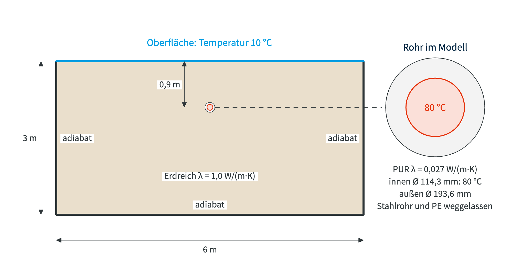

# Vorzeigebeispiel: Fernwärmerohr im Erdreich

Fernwärme bringt heißes Wasser vom Heizwerk zu den Häusern. Die Leitungen
liegen als **Kunststoffmantelrohre** im Erdreich: innen ein Stahlrohr für das
Wasser, darum eine dicke Dämmung aus PUR-Schaum, außen ein Mantel aus
Polyethylen (PE). Unterwegs geht ein Teil der Wärme ins Erdreich verloren. Wie
viel, entscheidet über die Dämmdicke und darüber, ob sich ein Wärmenetz lohnt.

!!! question "Die Aufgabe"
    Den **Wärmeverlust je Meter** eines Fernwärmerohrs im Erdreich bestimmen
    und dabei die Abstraktionen dieses Praktikums nutzen:

    - **a)** als **2D-Querschnitt** rechnen
    - **b)** als **Halbmodell** mit Symmetrie rechnen
    - **c)** mit einer **Netzstudie** prüfen, ob das Netz fein genug ist
    - **d)** einen **Pufferspeicher** rotationssymmetrisch rechnen und mit dem
      Herstellerwert vergleichen

<figure style="text-align:center;">
  
</figure>

??? info "Wie ein Kunststoffmantelrohr aufgebaut ist"
    Das Rohr hier ist ein Einzelrohr DN 100 der Dämmserie 1 aus dem Katalog
    eines Herstellers (Logstor, 06/2025):

    | Schicht | Maße | Wärmeleitfähigkeit |
    |---|---|---|
    | Stahlrohr | Ø 114,3 mm × 3,6 mm | $\lambda = 50\ \mathrm{W/(m\,K)}$ |
    | Dämmung (PUR-Schaum) | bis Ø 193,6 mm | $\lambda = 0{,}027\ \mathrm{W/(m\,K)}$ |
    | PE-Mantel | Ø 200 mm × 3,2 mm | $\lambda = 0{,}4\ \mathrm{W/(m\,K)}$ |

    Im Modell steht nur die Dämmung. Stahlrohr und PE-Mantel tragen zusammen
    0,4 % zum Wärmewiderstand bei, siehe
    [Abstraktionen](../../01_Grundlagen/Abstraktionen.md#schichten-weglassen).

## Gegeben

### Material

<!-- --8<-- [start:Material] -->
| Körper | Wärmeleitfähigkeit |
|---|---|
| Dämmung (PUR-Schaum) | $\lambda = 0{,}027\ \mathrm{W/(m\,K)}$ |
| Erdreich | $\lambda = 1{,}0\ \mathrm{W/(m\,K)}$ |
<!-- --8<-- [end:Material] -->

### Geometrie

<!-- --8<-- [start:Geometrie] -->
2D-Querschnitt mit der Dicke 1000 mm, das Ergebnis gilt also je Meter Rohr:

- Erdreich 6 m breit und 3 m tief, die Oberfläche oben
- Rohrachse mittig, 900 mm unter der Oberfläche
- Dämmung als Ring: innen Ø 114,3 mm, außen Ø 193,6 mm
- Innerhalb Ø 114,3 mm bleibt alles leer, Stahlrohr und Wasser sind nicht im Modell

Zwei Flächen mit Share Topology: **Erdreich** und **Daemmung**.
<!-- --8<-- [end:Geometrie] -->

### Vernetzung

<!-- --8<-- [start:Vernetzung] -->
- Netzgröße global: 50 mm
<!-- --8<-- [end:Vernetzung] -->

### Randbedingungen

<!-- --8<-- [start:Randbedingungen] -->
| Wo | Randbedingung | Wert |
|---|---|---|
| Innenrand der Dämmung (Kreis Ø 114,3 mm) | Temperatur (Vorlauf) | $T = 80\ \mathrm{°C}$ |
| Oberfläche des Erdreichs (obere Kante) | Temperatur | $T = 10\ \mathrm{°C}$ |
| Seiten und Unterkante | keine (adiabat) | |

!!! warning "Annahmen im Modell"
    - **Nur die Dämmung:** Stahlrohr und PE-Mantel fehlen. Mit ihnen läge der Wärmeverlust um 0,2 % niedriger
    - **Wasser direkt an der Dämmung:** Der Wärmeübergang vom Wasser zum Stahl ist vernachlässigt, die 80 °C liegen direkt am Innenrand der Dämmung
    - **Erdreich endlich:** Seiten und Unterkante sind adiabat. Ein größerer Block ändert den Wärmeverlust um weniger als 1 %
    - **Oberfläche 10 °C:** Die Temperatur der Erdoberfläche steht fest, wie in den Bezugsbedingungen der Hersteller (Überdeckung 0,8 m, Erdreich λ = 1,0 W/(m·K), 10 °C)
<!-- --8<-- [end:Randbedingungen] -->

## Gesucht

<!-- --8<-- [start:Gesucht] -->
1. Wärmeverlust je Meter Rohr in W/m
2. Vergleich mit der Handrechnung und mit der Angabe des Herstellers
<!-- --8<-- [end:Gesucht] -->

??? info "Zum Nachrechnen: Wärmeverlust von Hand"
    Die Dämmung ist ein Hohlzylinder, das Erdreich ein Zylinder unter einer
    Oberfläche mit fester Temperatur. Beide liegen wie Widerstände in Reihe
    (siehe [Abstraktionen](../../01_Grundlagen/Abstraktionen.md#schichten-weglassen)):

    $$
    R_\mathrm{PUR} = \frac{\ln(96{,}8/57{,}15)}{2\pi \cdot 0{,}027}\ \mathrm{\tfrac{m\,K}{W}} = 3{,}106\ \mathrm{\tfrac{m\,K}{W}}
    \qquad
    R_\mathrm{Erdreich} = \frac{\operatorname{arcosh}(2 \cdot 900/193{,}6)}{2\pi \cdot 1{,}0}\ \mathrm{\tfrac{m\,K}{W}} = 0{,}465\ \mathrm{\tfrac{m\,K}{W}}
    $$

    $$
    \dot Q' = \frac{T_V - T_O}{R_\mathrm{PUR} + R_\mathrm{Erdreich}}
    = \frac{70\ \mathrm{K}}{3{,}571\ \mathrm{m\,K/W}} = 19{,}6\ \mathrm{W/m}
    $$

    mit

    - $R_\mathrm{PUR}$, $R_\mathrm{Erdreich}$: Wärmewiderstand von Dämmung und Erdreich je Meter Rohr
    - 57,15 mm und 96,8 mm: Innen- und Außenradius der Dämmung
    - 900 mm: Tiefe der Rohrachse, 193,6 mm: Außendurchmesser der Dämmung
    - $\dot Q'$: Wärmeverlust je Meter Rohr
    - $T_V = 80\ \mathrm{°C}$: Vorlauf, $T_O = 10\ \mathrm{°C}$: Oberfläche

    Die Dämmung trägt 87 % des Widerstands. Die Formel für das Erdreich gilt für
    ein unendlich ausgedehntes Erdreich. Der Hersteller gibt für dieses Rohr
    einen Wärmedurchgang von 0,271 W/(m·K) je Meter an (bei 0,6 m Überdeckung),
    bei 70 K also 19,0 W/m.

## Lösungswege

-   <a class="card-link" href="01-modell/">
    __a) Querschnitt__: 2D-Modell aufbauen, Temperaturen anbringen, Wärmeverlust ablesen
    </a>

-   <a class="card-link" href="b-halbmodell/">
    __b) Halbmodell__: dasselbe mit Symmetrie und halb so vielen Elementen
    </a>

-   <a class="card-link" href="c-netzstudie/">
    __c) Netzstudie__: Wann ist das Netz fein genug?
    </a>

-   <a class="card-link" href="d-pufferspeicher/">
    __d) Pufferspeicher__: ein Drehkörper als Halbschnitt
    </a>

